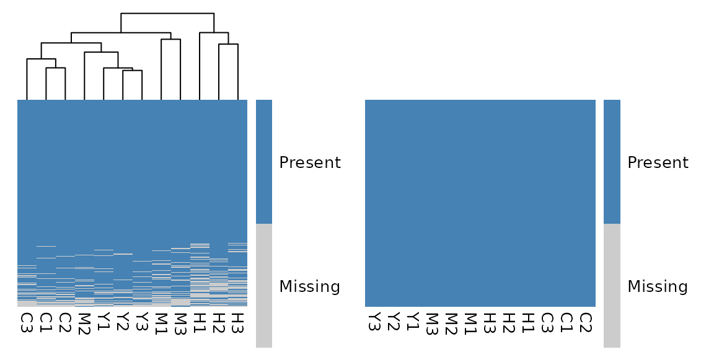

# Get Started with glyclean

## Getting Started

Preparing data is an important first step in glycomics and
glycoproteomics analysis. Depending on the experiment, this can include
normalization, handling missing values, and correcting batch effects.

`glyclean` provides preprocessing methods for glycomics and
glycoproteomics data. Its functions work with
[`glyexp::GlycomicSE`](https://glycoverse.github.io/glyexp/reference/GlycomicSE.html)
and
[`glyexp::GlycoproteomicSE`](https://glycoverse.github.io/glyexp/reference/GlycoproteomicSE.html)
objects and return the same subclass they receive. If these objects are
new to you, start with the [glyexp
introduction](https://glycoverse.github.io/glyexp/articles/glyexp.html).
The [glyread](https://github.com/glycoverse/glyread) package can help
you import data into the `glycoverse` ecosystem.

``` r

library(glyclean)
#> 
#> Attaching package: 'glyclean'
#> The following object is masked from 'package:stats':
#> 
#>     aggregate
library(glyexp)
#> Warning: replacing previous import 'S4Arrays::makeNindexFromArrayViewport' by
#> 'DelayedArray::makeNindexFromArrayViewport' when loading 'SummarizedExperiment'
```

## Example Data

Let’s start with a real-world dataset to explore what `glyclean` can do.
We’ll use the bundled
[`glyexp::real_experiment`](https://glycoverse.github.io/glyexp/reference/real_experiment.html)
dataset, which is a
[`glyexp::GlycoproteomicSE`](https://glycoverse.github.io/glyexp/reference/GlycoproteomicSE.html)
object.

``` r

exp <- real_experiment
exp <- mutate_col(exp, batch = factor(rep(c("A", "B", "C"), 4)))
exp
#> 
#> ── GlycoproteomicSE ────────────────────────────────────────────────────────────
#> ℹ Abundance assay: 12 samples, 4262 variables
#> ℹ Glycan type: N
#> ℹ Row data fields: peptide <chr>, peptide_site <int>, protein <chr>, protein_site <int>, gene <chr>, glycan_composition <comp>, glycan_structure <struct>
#> ℹ Column data fields: group <fct>, batch <fct>
#> ℹ Metadata fields: exp_type <chr>, glycan_type <chr>, quant_method <chr>
```

First, let’s take a look at the feature and sample metadata:

``` r

tibble::as_tibble(rowData(exp), rownames = "variable")
#> # A tibble: 4,262 × 8
#>    variable   peptide peptide_site protein protein_site gene  glycan_composition
#>    <chr>      <chr>          <int> <chr>          <int> <chr> <comp>            
#>  1 P08185-17… NKTQGK             1 P08185           176 SERP… Hex(5)HexNAc(4)Ne…
#>  2 P04196-34… HSHNNN…            5 P04196           344 HRG   Hex(5)HexNAc(4)Ne…
#>  3 P04196-34… HSHNNN…            5 P04196           344 HRG   Hex(5)HexNAc(4)   
#>  4 P04196-34… HSHNNN…            5 P04196           344 HRG   Hex(5)HexNAc(4)Ne…
#>  5 P10909-29… HNSTGC…            2 P10909           291 CLU   Hex(6)HexNAc(5)   
#>  6 P04196-34… HSHNNN…            5 P04196           344 HRG   Hex(5)HexNAc(4)Ne…
#>  7 P04196-34… HSHNNN…            6 P04196           345 HRG   Hex(5)HexNAc(4)   
#>  8 P04196-34… HSHNNN…            5 P04196           344 HRG   Hex(5)HexNAc(4)dH…
#>  9 P04196-34… HSHNNN…            5 P04196           344 HRG   Hex(4)HexNAc(3)   
#> 10 P04196-34… HSHNNN…            5 P04196           344 HRG   Hex(4)HexNAc(4)Ne…
#> # ℹ 4,252 more rows
#> # ℹ 1 more variable: glycan_structure <struct>
```

``` r

tibble::as_tibble(colData(exp), rownames = "sample")
#> # A tibble: 12 × 3
#>    sample group batch
#>    <chr>  <fct> <fct>
#>  1 C1     C     A    
#>  2 C2     C     B    
#>  3 C3     C     C    
#>  4 H1     H     A    
#>  5 H2     H     B    
#>  6 H3     H     C    
#>  7 M1     M     A    
#>  8 M2     M     B    
#>  9 M3     M     C    
#> 10 Y1     Y     A    
#> 11 Y2     Y     B    
#> 12 Y3     Y     C
```

This N-glycoproteomics dataset contains 500 peptide-spectrum matches
(PSMs) across 12 samples. The samples come from three batches and
represent four biological groups.

## A Starting Point: `auto_clean()`

[`auto_clean()`](https://glycoverse.github.io/glyclean/dev/reference/auto_clean.md)
provides a convenient starting point for preprocessing:

``` r

clean_exp <- auto_clean(exp)
#> 
#> ── Removing variables with too many missing values ──
#> 
#> ℹ Applying preset "discovery"...
#> ℹ Total removed: 24 (0.56%) variables.
#> ✔ Variable removal completed.
#> 
#> ── Normalizing data ──
#> 
#> ℹ Normalization method: `normalize_median()`
#> ℹ Reason: default for "glycoproteomics".
#> ✔ Normalization completed.
#> 
#> ── Imputing missing values ──
#> 
#> ℹ Imputation method: `impute_min_prob()`
#> ℹ Reason: default for "glycoproteomics" with n_samples < 30.
#> ✔ Imputation completed.
#> 
#> ── Aggregating data ──
#> 
#> ✔ Aggregation completed.
#> 
#> ── Normalizing data again ──
#> 
#> ℹ Normalization method: `normalize_median()`
#> ℹ Reason: default for "glycoproteomics".
#> ✔ Normalization completed.
#> 
#> ── Correcting batch effects ──
#> 
#> ℹ Batch effects detected in "2.5%" of variables (<= "30.0%"). Skipping batch correction.
#> ✔ Batch correction completed.
```

The function applies a sequence of preprocessing steps using automatic
defaults. You can inspect those steps and adjust your workflow to suit
the experiment.

## Understanding the Automatic Pipeline

Let’s look at what
[`auto_clean()`](https://glycoverse.github.io/glyclean/dev/reference/auto_clean.md)
does. Here is a simplified version of the function:

``` r

auto_clean <- function(exp, ...) {
  # ... are other arguments, see documentation for more details
  if (glyexp::is_glycoproteomic_se(exp)) {
    exp <- auto_normalize(exp, ...)
    exp <- auto_remove(exp, ...)
    exp <- auto_impute(exp, ...)
    exp <- glyclean::aggregate(exp)
    exp <- auto_normalize(exp, ...)
    exp <- auto_correct_batch_effect(exp, ...)
  } else if (glyexp::is_glycomic_se(exp)) {
    exp <- auto_remove(exp, ...)
    exp <- auto_impute(exp, ...)
    exp <- glyclean::aggregate(exp)
    exp <- auto_normalize(exp, ...)
    exp <- auto_correct_batch_effect(exp, ...)
  } else {
    stop("The experiment type must be 'glycoproteomics' or 'glycomics'.")
  }
  exp
}
```

As you can see,
[`auto_clean()`](https://glycoverse.github.io/glyclean/dev/reference/auto_clean.md)
calls the following functions in sequence:

- [`auto_normalize()`](https://glycoverse.github.io/glyclean/dev/reference/auto_normalize.md):
  Automatically normalize the data
- [`auto_remove()`](https://glycoverse.github.io/glyclean/dev/reference/auto_remove.md):
  Automatically remove variables with too many missing values
- [`auto_impute()`](https://glycoverse.github.io/glyclean/dev/reference/auto_impute.md):
  Automatically impute the missing values
- [`aggregate()`](https://glycoverse.github.io/glyclean/dev/reference/aggregate.md):
  Aggregate automatically or to an explicitly selected level
- [`auto_correct_batch_effect()`](https://glycoverse.github.io/glyclean/dev/reference/auto_correct_batch_effect.md):
  Automatically correct the batch effects

These functions apply deterministic defaults for the given dataset.

**How
[`auto_normalize()`](https://glycoverse.github.io/glyclean/dev/reference/auto_normalize.md)
works:**

- **When QC samples are available**: QC samples do not change the
  automatic method choice and are not used for normalization
  diagnostics.

- **For glycomics data**: Total area normalization is used as the
  default.

- **For glycoproteomics data and other experiment types**: Median
  normalization is used as the default.

You can make a custom pipeline by calling these functions in different
orders:

``` r

clean_exp <- exp |>
  auto_remove() |>
  auto_normalize() |>
  auto_impute() |>
  glyclean::aggregate()
#> ℹ Applying preset "discovery"...
#> ℹ Total removed: 24 (0.56%) variables.
#> ℹ Normalization method: `normalize_median()`
#> ℹ Reason: default for "glycoproteomics".
#> ℹ Imputation method: `impute_min_prob()`
#> ℹ Reason: default for "glycoproteomics" with n_samples < 30.
```

## Input scales

For supported `raw`, `log`, `log2`, and `log10` inputs, `glyclean`
performs the scale conversions required by the selected method. You do
not need to convert the data to its working scale manually.

Most preprocessing methods preserve the input scale, while filters
retain the original values. CoDA and VSN instead return log-like
coordinates marked as `logx`.

Supported input scales vary by method, including whether `logx` is
accepted. See [the scale
reference](https://glycoverse.github.io/glyclean/dev/reference/data_scales.md)
([`?data_scales`](https://glycoverse.github.io/glyclean/dev/reference/data_scales.md))
for supported inputs, working scales, and exceptions.

## Step-by-Step Preprocessing

The `auto_xxx()` functions offer a convenient starting point. For more
control, you can choose and apply individual methods at each step.

### Step 1: Normalization

Normalization helps make intensities more comparable across samples.

**Available normalization methods in `glyclean`:**

| Function | Description | Best For |
|----|----|----|
| [`normalize_median()`](https://glycoverse.github.io/glyclean/dev/reference/normalize_median.md) | Median-based normalization | General use, robust to outliers |
| [`normalize_median_abs()`](https://glycoverse.github.io/glyclean/dev/reference/normalize_median_abs.md) | Absolute median normalization | When you need extra robustness |
| [`normalize_median_quotient()`](https://glycoverse.github.io/glyclean/dev/reference/normalize_median_quotient.md) | Median quotient method | Glycomics data (compositional) |
| [`normalize_quantile()`](https://glycoverse.github.io/glyclean/dev/reference/normalize_quantile.md) | Quantile normalization | When you want identical distributions |
| [`normalize_total_area()`](https://glycoverse.github.io/glyclean/dev/reference/normalize_total_area.md) | Total area normalization | Relative abundance data |
| [`normalize_rlr()`](https://glycoverse.github.io/glyclean/dev/reference/normalize_rlr.md) | Robust linear regression | Complex batch designs |
| [`normalize_rlrma()`](https://glycoverse.github.io/glyclean/dev/reference/normalize_rlrma.md) | Robust linear regression with median adjustment | Complex batch designs |
| [`normalize_rlrmacyc()`](https://glycoverse.github.io/glyclean/dev/reference/normalize_rlrmacyc.md) | Robust linear regression with median adjustment and cyclic smoothing | Complex batch designs |
| [`normalize_loessf()`](https://glycoverse.github.io/glyclean/dev/reference/normalize_loessf.md) | LOESS with feature smoothing | Non-linear trends |
| [`normalize_loesscyc()`](https://glycoverse.github.io/glyclean/dev/reference/normalize_loesscyc.md) | LOESS with cyclic smoothing | Cyclic data |
| [`normalize_vsn()`](https://glycoverse.github.io/glyclean/dev/reference/normalize_vsn.md) | Variance stabilizing normalization | Heteroscedastic data |
| [`transform_clr()`](https://glycoverse.github.io/glyclean/dev/reference/transform_clr.md) | Centered Log-Ratio transformation | Glycomics and site-wise glycoproteomics data |
| [`transform_alr()`](https://glycoverse.github.io/glyclean/dev/reference/transform_alr.md) | Additive Log-Ratio transformation | Glycomics data (compositional) |

Many normalization functions accept a `by` parameter for normalization
within groups. It can take a column name from the sample metadata or a
vector, including a grouping that is not stored in the experiment
object.

``` r

# Example: Using by parameter with a custom vector
# Normalize within custom groups (e.g., based on some external criteria)
custom_groups <- c("A", "A", "B", "B", "C", "C", "A", "A", "B", "B", "C", "C")
normalized_exp <- normalize_median_quotient(exp, by = custom_groups)
```

**Compositional Data: CLR and ALR**

For glycomics data (where intensities represent relative abundances of
glycans), standard normalization methods may not be appropriate.
Instead, compositional data analysis techniques are recommended:

- **[`transform_clr()`](https://glycoverse.github.io/glyclean/dev/reference/transform_clr.md)**:
  Centered Log-Ratio transformation. A robust method for compositional
  data analysis. The result remains on the `log2`-ratio scale, with
  experiment metadata `scale = "logx"`.

- **[`transform_alr()`](https://glycoverse.github.io/glyclean/dev/reference/transform_alr.md)**:
  Additive Log-Ratio transformation. The reference glycan is chosen
  based on Procrustes correlation to CLR geometry and minimal
  between-group variance, and the final result remains on the
  `log2`-ratio scale (`scale = "logx"`). If no suitable reference is
  found, ALR falls back to CLR.

The CLR and ALR methods align with the best practices described in DOI:
10.1038/s41467-025-56249-3 for glycomics data preprocessing.

Here we apply median normalization explicitly:

``` r

normed_exp <- normalize_median(exp)
```

### Step 2: Variable Filtering

Filtering can remove variables with too many missing values or too
little variation for the analysis.

**Available variable filtering functions in `glyclean`:**

| Function | Description | Best For |
|----|----|----|
| [`remove_rare()`](https://glycoverse.github.io/glyclean/dev/reference/remove_rare.md) | Remove variables with too many missing values | General use |
| [`remove_low_var()`](https://glycoverse.github.io/glyclean/dev/reference/remove_low_var.md) | Remove variables with low variance | General use |
| [`remove_low_cv()`](https://glycoverse.github.io/glyclean/dev/reference/remove_low_cv.md) | Remove variables with low coefficient of variation | General use |
| [`remove_constant()`](https://glycoverse.github.io/glyclean/dev/reference/remove_constant.md) | Remove constant variables | General use |
| [`remove_low_expr()`](https://glycoverse.github.io/glyclean/dev/reference/remove_low_expr.md) | Remove variables with low expression | General use |

Here we remove variables with more than 50% missing values in all
samples:

``` r

filtered_exp <- remove_rare(normed_exp, prop = 0.5)
#> ℹ Removed 137 of 4262 (3.21%) variables.
```

### Step 3: Imputation

Missing values in mass spectrometry data can arise through different
mechanisms. For example, low-abundance ions may be missed because of
poor ionization efficiency or because their signal falls below the
detection threshold. Consider the likely cause of missingness when
choosing an imputation method.

**Available imputation methods:**

| Function | Method | Best For |
|----|----|----|
| [`impute_zero()`](https://glycoverse.github.io/glyclean/dev/reference/impute_zero.md) | Replace with zeros | Quick and simple |
| [`impute_sample_min()`](https://glycoverse.github.io/glyclean/dev/reference/impute_sample_min.md) | Sample minimum values | Small datasets |
| [`impute_half_sample_min()`](https://glycoverse.github.io/glyclean/dev/reference/impute_half_sample_min.md) | Half of sample minimum | Conservative approach |
| [`impute_min_prob()`](https://glycoverse.github.io/glyclean/dev/reference/impute_min_prob.md) | Probabilistic minimum | Medium datasets |
| [`impute_miss_forest()`](https://glycoverse.github.io/glyclean/dev/reference/impute_miss_forest.md) | Random Forest ML | Large datasets |
| [`impute_bpca()`](https://glycoverse.github.io/glyclean/dev/reference/impute_bpca.md) | Bayesian PCA | High correlation structure |
| [`impute_ppca()`](https://glycoverse.github.io/glyclean/dev/reference/impute_ppca.md) | Probabilistic PCA | Linear relationships |
| [`impute_sw_knn()`](https://glycoverse.github.io/glyclean/dev/reference/impute_sw_knn.md) | K-nearest neighbors (Sample-wise) | Local similarity patterns |
| [`impute_fw_knn()`](https://glycoverse.github.io/glyclean/dev/reference/impute_fw_knn.md) | K-nearest neighbors (Feature-wise) | Local similarity patterns |
| [`impute_svd()`](https://glycoverse.github.io/glyclean/dev/reference/impute_svd.md) | Singular value decomposition | High correlation structure |

For demonstration, let’s use the simple zero imputation:

``` r

imputed_exp <- impute_zero(filtered_exp)
```

### Step 4: Aggregation – From Peptides to Glycoforms

Search engines typically report glycoproteomics results at the PSM or
peptide level. Aggregation can bring these measurements together at a
level suited to the analysis, such as glycoforms defined by a glycan and
a protein site. One glycoform can appear multiple times in the data due
to:

- Different charge states
- Post-translational modifications
- Missed protease cleavages
- Different peptide sequences covering the same site

**Available aggregation levels:**

- **“gps”**: Glycopeptides with structures (most detailed)
- **“gp”**: Glycopeptides with compositions
- **“gfs”**: Glycoforms with structures (recommended default)
- **“gf”**: Glycoforms with compositions (most condensed)

``` r

aggregated_exp <- glyclean::aggregate(imputed_exp, to_level = "gf")
```

You can normalize again after aggregation to account for changes in the
intensity distributions:

``` r

aggregated_exp2 <- normalize_median(aggregated_exp)
```

### Step 5: Batch Effect Correction

Differences in instruments, reagents, or environmental conditions can
introduce systematic variation between batches, even when protocols are
consistent. Batch effect correction is most useful when the experimental
design allows batch and biological effects to be distinguished.

``` r

# To detect batch effects:
p_values <- detect_batch_effect(aggregated_exp2)
#> ℹ Detecting batch effects using ANOVA for 2738 variables...
#> ✔ Batch effect detection completed. 15 out of 2738 variables show significant batch effects (p < 0.05).
p_values[1:5]
#> P08185-176-Hex(5)HexNAc(4)NeuAc(2) P04196-344-Hex(5)HexNAc(4)NeuAc(1) 
#>                          0.4665611                          0.3007360 
#>         P04196-344-Hex(5)HexNAc(4)         P10909-291-Hex(6)HexNAc(5) 
#>                          0.5136274                          0.3010584 
#> P04196-344-Hex(5)HexNAc(4)NeuAc(2) 
#>                          0.4419162
```

For demonstration, we can also apply batch effect correction to this
dataset:

``` r

# To correct batch effects:
corrected_exp <- correct_batch_effect(aggregated_exp2)
#> Found3batches
#> Adjusting for0covariate(s) or covariate level(s)
#> Standardizing Data across genes
#> Fitting L/S model and finding priors
#> Finding parametric adjustments
#> Adjusting the Data
```

### Step 6: Protein Expression Adjustment

Glycopeptide intensity can reflect both protein abundance and
glycosylation. When protein expression measurements are available,
[`adjust_protein()`](https://glycoverse.github.io/glyclean/dev/reference/adjust_protein.md)
can help account for protein abundance when investigating glycosylation
changes.

``` r

# We don't run the code here because we don't have the protein expression matrix.
adjusted_exp <- adjust_protein(inferred_exp, pro_expr_mat)
```

The protein expression matrix should be preprocessed and contain the
same samples as the glycopeptide data, with samples matched correctly.
You can wrap protein expression data in a `SummarizedExperiment` object
to use `glyclean` preprocessing functions.

The example workflow has now covered normalization, filtering,
imputation, aggregation, and batch correction. Choose and assess these
steps for your own data and analysis goals.

## Advanced Usage: Flexible Grouping with Custom Vectors

Many functions in `glyclean` accept a `by` parameter for stratified
processing. It accepts both column names from the sample metadata and
vectors.

``` r

# Using column names (standard approach)
normalized_exp <- normalize_median_quotient(exp, by = "group")

# Using custom vectors (advanced approach)
custom_groups <- c("A", "A", "B", "B", "C", "C", "A", "A", "B", "B", "C", "C")
normalized_exp <- normalize_median_quotient(exp, by = custom_groups)
```

This also lets you use groupings that are not stored in the experiment
object.

## Quality Control (QC)

`glyclean` provides quality control plots to help you assess data at
different stages of preprocessing.

**Available QC plotting functions in `glyclean`:**

| Function | Description | Best For |
|----|----|----|
| [`plot_missing_heatmap()`](https://glycoverse.github.io/glyclean/dev/reference/plot_missing_heatmap.md) | Binary heatmap of missing value patterns | Visualizing global missingness structure |
| [`plot_missing_bar()`](https://glycoverse.github.io/glyclean/dev/reference/plot_missing_bar.md) | Bar plot of missing proportions | Identifying samples/variables with high missingness |
| [`plot_tic_bar()`](https://glycoverse.github.io/glyclean/dev/reference/plot_tic_bar.md) | Total intensity (TIC) bar plot | Checking for systematic intensity differences between samples |
| [`plot_rank_abundance()`](https://glycoverse.github.io/glyclean/dev/reference/plot_rank_abundance.md) | Protein rank abundance plot | Assessing the dynamic range of detected proteins |
| [`plot_int_boxplot()`](https://glycoverse.github.io/glyclean/dev/reference/plot_int_boxplot.md) | Log2-intensity boxplots | Visualizing data distribution and normalization effects |
| [`plot_rle()`](https://glycoverse.github.io/glyclean/dev/reference/plot_rle.md) | Relative Log Expression (RLE) boxplots | Detecting sample-wise bias and batch effects |
| [`plot_cv_dent()`](https://glycoverse.github.io/glyclean/dev/reference/plot_cv_dent.md) | CV density plot | Assessing reproducibility and technical variation |
| [`plot_batch_pca()`](https://glycoverse.github.io/glyclean/dev/reference/plot_batch_pca.md) | PCA score plot by batch | Visualizing batch effects and sample clustering |
| [`plot_rep_scatter()`](https://glycoverse.github.io/glyclean/dev/reference/plot_rep_scatter.md) | Replicate scatter plots | Checking concordance between replicate samples |

These functions work with
[`glyexp::GlycomicSE`](https://glycoverse.github.io/glyexp/reference/GlycomicSE.html)
and
[`glyexp::GlycoproteomicSE`](https://glycoverse.github.io/glyexp/reference/GlycoproteomicSE.html)
objects and use `ggplot2` for visualization.

For example, you can use
[`plot_missing_heatmap()`](https://glycoverse.github.io/glyclean/dev/reference/plot_missing_heatmap.md)
to visualize the missing values in your data before and after cleaning:

``` r

library(patchwork)

plot_missing_heatmap(exp) + plot_missing_heatmap(clean_exp)
```



## Revisit the History

All preprocessing steps applied to an experiment are recorded and stored
as a pipeline object. You can get it with
[`get_pipeline()`](https://glycoverse.github.io/glyclean/dev/reference/glyclean_pipeline.md).

``` r

history <- get_pipeline(clean_exp)
history
#> 
#> ── <glyclean_pipeline> 5 steps ─────────────────────────────────────────────────
#> 1. remove_rare
#>    prop = 0.8, n = NULL, by = NULL, strict = FALSE, min_n = 1
#> 2. remove_rare
#>    prop = 0.5, n = NULL, by = "group", strict = FALSE, min_n = 1
#> 3. normalize_median
#>    (no parameters)
#> 4. impute_min_prob
#>    by = NULL, q = 0.01, tune.sigma = 1, seed = 123
#> 5. aggregate
#>    to_level = "gfs", standardize_variable = TRUE, f = base::sum, seed = 123
```

You can reapply the recorded pipeline to the original experiment and
compare the result:

``` r

identical(apply_pipeline(exp, history), clean_exp)
#> ℹ Removed 18 of 4262 (0.42%) variables.
#> ℹ Removed 6 of 4244 (0.14%) variables.
#> [1] TRUE
```

## What’s Next?

Once you have assessed your preprocessed data, you can move on to
analyses such as:

- **Differential analysis**: Find glycans that change between conditions
- **Pathway analysis**: Understand biological processes
- **Machine learning**: Build predictive models
- **Visualization**: Explore and communicate patterns in the data

The `glycoverse` ecosystem provides tools for these next steps.
